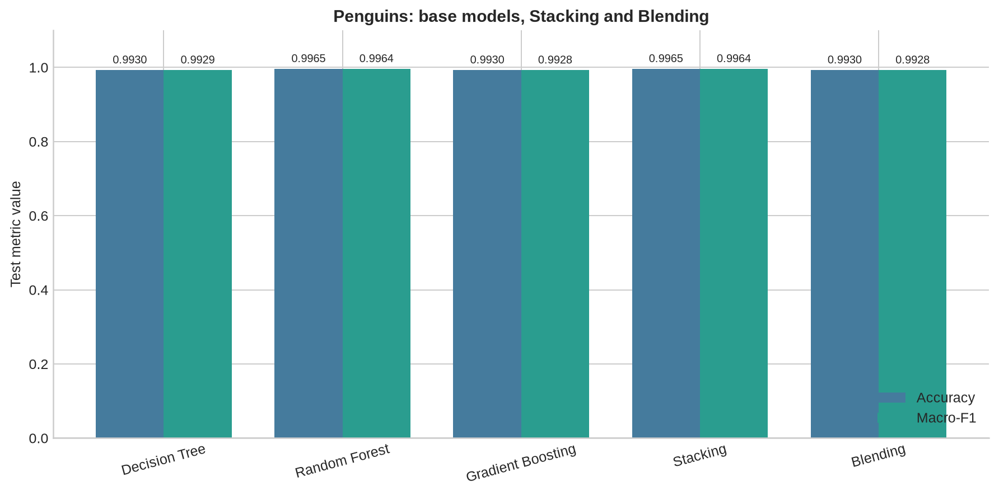
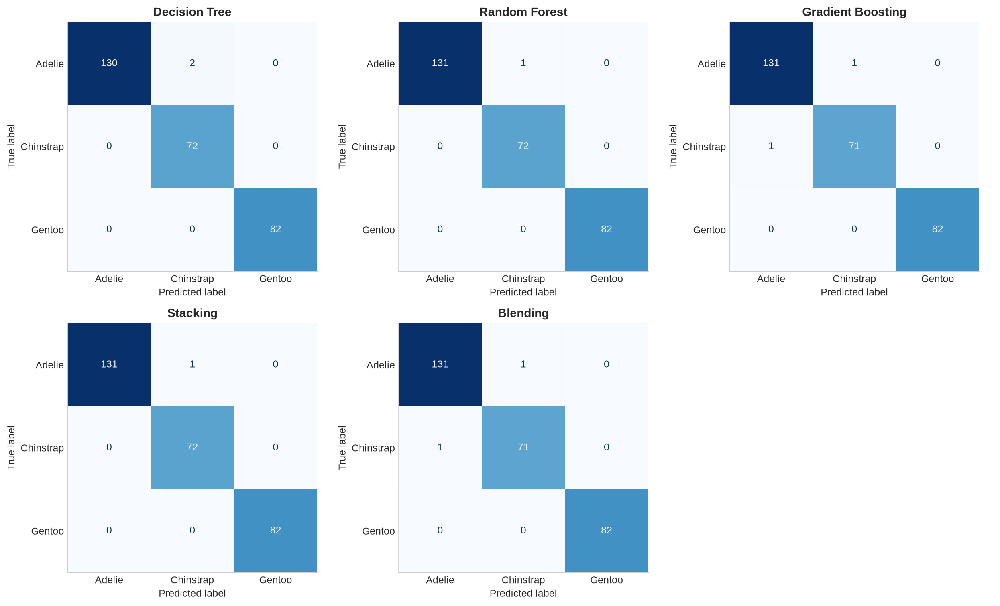

# Практическая работа №9 — вариант 1

**Тема:** Ensemble Learning: Stacking и Blending.  
**Задача:** классификация видов пингвинов (Penguins species classification).

## Цель

Сравнить Decision Tree, Random Forest, Gradient Boosting, Stacking и Blending
на одной тестовой выборке, обработать числовые и категориальные признаки
без утечки данных и оценить ошибки по видам.

## Данные

Источник эксперимента — предоставленный пользователем архив
[`archive.zip`](../../data/raw/archive.zip), файл `Penguin Species Prediction Dataset.csv`.
В методичке указан Palmer Penguins; в этой работе используется
предоставленная таблица: **1000 исходных строк, 6 признаков и 3 класса**.
После удаления строк с пропусками осталось **951 полных наблюдений**.
В архиве нет описания происхождения и способа формирования этих 1000 строк;
его результаты относятся к этой версии данных.
Исходное задание: [практическая №9](../../docs/assignments/practical_09.docx).

Целевая переменная — `species`: Adelie, Chinstrap, Gentoo.
Числовые признаки: `culmen_length_mm` (длина клюва), `culmen_depth_mm`
(глубина клюва), `flipper_length_mm` (длина ласта), `body_mass_g` (масса).
Категориальные признаки: `island` (остров) и `sex` (пол).
Точных дубликатов в очищенной таблице: **0**.
Удалены **49 строк** хотя бы с одним пропуском;
оставшиеся строки содержат **0 пропусков**.
Полные наблюдения сохранены в
[`penguins_clean.csv`](../../data/processed/penguins_clean.csv),
исключённые исходные строки и причины удаления — в `removed_rows.csv`.
`species` и номер строки не включаются в признаки.

### Баланс классов

| species | count | share |
| --- | --- | --- |
| Adelie | 438 | 0.4606 |
| Chinstrap | 240 | 0.2524 |
| Gentoo | 273 | 0.2871 |

Доли классов различаются, поэтому вместе с Accuracy рассчитываются
macro-F1, macro-Precision, macro-Recall и multiclass ROC-AUC (OvR, macro).
Macro-усреднение придаёт одинаковый вес каждому виду.

### Пропуски до и после удаления строк

| column | missing_count_before | missing_share_before | missing_count_after | missing_share_after |
| --- | --- | --- | --- | --- |
| species | 0 | 0.0000 | 0 | 0.0000 |
| culmen_length_mm | 10 | 0.0100 | 0 | 0.0000 |
| culmen_depth_mm | 10 | 0.0100 | 0 | 0.0000 |
| flipper_length_mm | 10 | 0.0100 | 0 | 0.0000 |
| body_mass_g | 10 | 0.0100 | 0 | 0.0000 |
| island | 0 | 0.0000 | 0 | 0.0000 |
| sex | 10 | 0.0100 | 0 | 0.0000 |

Применяется удаление неполных наблюдений: `raw.dropna()` до разбиения на выборки.
Значения не заполняются; `SimpleImputer` исключён из всех моделей.
Числовые признаки передаются без изменений, категориальные кодируются через
One-Hot Encoding (`handle_unknown='ignore'`).
`ColumnTransformer` находится внутри каждого базового `Pipeline`.
Для отдельных моделей кодировщик обучается на train, для Stacking — заново
внутри обучающей части каждого OOF-фолда, для Blending — на base-train.
Метамодель использует `StandardScaler` и `LogisticRegression(max_iter=2000)`;
масштабирование метапризнаков обучается вместе с метамоделью.

## Разбиение и обучение

`random_state=42` во всех случайных операциях; разбиения стратифицированы по `species`.
Параметры заданы до оценки; test не используется для подбора параметров.

| split | rows | Adelie | Chinstrap | Gentoo |
| --- | --- | --- | --- | --- |
| train | 665 | 306 | 168 | 191 |
| test | 286 | 132 | 72 | 82 |
| blending_base | 465 | 214 | 117 | 134 |
| blending_validation | 200 | 92 | 51 | 57 |

- Отдельные модели обучены на 665 строках train.
- **Stacking:** `StratifiedKFold(n_splits=5, shuffle=True, random_state=42)`;
  каждая обучающая строка получает вероятности от моделей, которые её не видели.
  Метамодель обучена на OOF-матрице размера 665 × 9
  (3 модели × 3 вида); затем базовые модели обучены на всём train для инференса.
- **Blending:** базовые модели обучены на 465 строках, метамодель —
  на вероятностях для 200 отдельных validation-строк (матрица 200 × 9).
  После этого базовые модели сохраняются без переобучения.
- **Test:** общие 286 строк для итоговой оценки всех пяти моделей.

Распределение каждой сохранённой строки записано в `data_split.csv`:
`source_row` — индекс строки данных с нуля, `oof_fold` — номер фолда,
в котором строка служит OOF-validation, `blending_role` — base или validation.
Test не участвует в обучении базовых моделей, кодировщиков,
масштабирования или метамоделей.

## Код моделей и воспроизведение

Полная реализация предобработки, моделей, метрик и графиков:
[`lab09_ensemble_learning.py`](../../src/breast_cancer_labs/labs/lab09_ensemble_learning.py).
Загрузчик: [`penguins_data.py`](../../src/breast_cancer_labs/penguins_data.py).
Decision Tree: `max_depth=3`; Random Forest: `n_estimators=100`;
Gradient Boosting: `n_estimators=100`, `learning_rate=0.1`, `max_depth=3`.
Остальные параметры используются по умолчанию из версии scikit-learn,
зафиксированной в `environment.json`.

Ключевая последовательность (запускается из корня с `PYTHONPATH=src`):

```python
from sklearn.base import clone
from sklearn.model_selection import train_test_split
from breast_cancer_labs.labs.lab09_ensemble_learning import (
    build_base_models, build_stacking, fit_blending,
    evaluate, ordered_probabilities,
)
from breast_cancer_labs.penguins_data import FEATURE_NAMES, load_penguins_dataset

data = load_penguins_dataset()
X_train, X_test, y_train, y_test = train_test_split(
    data[FEATURE_NAMES], data['species'], test_size=0.30,
    random_state=42, stratify=data['species'],
)
base_models = build_base_models()  # каждый содержит свой preprocessing Pipeline
models = {name: clone(model).fit(X_train, y_train) for name, model in base_models}
models['Stacking'] = build_stacking(base_models).fit(X_train, y_train)
X_base, X_valid, y_base, y_valid = train_test_split(
    X_train, y_train, test_size=0.30, random_state=42, stratify=y_train,
)
models['Blending'] = fit_blending(base_models, X_base, y_base, X_valid, y_valid)
for name, model in models.items():
    print(evaluate(name, y_test, model.predict(X_test), ordered_probabilities(model, X_test)))
```

Полный запуск с сохранением всех результатов:

```bash
PYTHONPATH=src .venv/bin/python -m breast_cancer_labs.labs.lab09_ensemble_learning
```

## Метрики на test

| model | accuracy | precision_macro | recall_macro | f1_macro | roc_auc_ovr_macro |
| --- | --- | --- | --- | --- | --- |
| Decision Tree | 0.9930 | 0.9910 | 0.9949 | 0.9929 | 0.9973 |
| Random Forest | 0.9965 | 0.9954 | 0.9975 | 0.9964 | 0.9987 |
| Gradient Boosting | 0.9930 | 0.9928 | 0.9928 | 0.9928 | 0.9990 |
| Stacking | 0.9965 | 0.9954 | 0.9975 | 0.9964 | 0.9989 |
| Blending | 0.9930 | 0.9928 | 0.9928 | 0.9928 | 0.9984 |

### График 1 — Accuracy и macro-F1



Столбцы показывают результаты на одинаковых 286 тестовых объектах;
ось Y начинается с нуля. При отличающихся долях видов macro-F1 помогает
оценивать качество с равным весом каждого класса.

### График 2 — матрицы ошибок по видам



Строки — истинные виды, столбцы — предсказанные.
Диагональ соответствует правильным ответам, остальные клетки показывают
направление и число ошибок; для всех моделей используется одна цветовая шкала.
Подробные precision/recall/F1 по видам находятся в `classification_report.csv`,
численные матрицы — в `confusion_matrix_values.csv`.

## Сравнительный анализ (7 предложений)

1. Максимальная Accuracy равна 0.9965; её показали Random Forest, Stacking.
2. Максимальный macro-F1 равен 0.9964; лучший результат у Random Forest, Stacking.
3. Stacking повторил лучший macro-F1 отдельных моделей, поэтому дополнительного выигрыша от объединения моделей на этом test нет.
4. ROC-AUC Stacking равен 0.9989, а Blending — 0.9984; эта метрика оценивает ранжирование вероятностей и может различаться даже при одинаковых итоговых классах.
5. В Stacking метамодель использует OOF-прогнозы для всех 665 train-строк, а в Blending — только 200 validation-строк при обучении базовых моделей на 465 строках.
6. Число ошибок Stacking — 1, Blending — 2 на 286 тестовых объектах; самая частая ошибка Stacking — Adelie → Chinstrap (1 объект).
7. Строки с пропусками удалены до разбиения, а кодировщики обучаются внутри соответствующих train-частей, поэтому test и OOF-validation не передают категории в обучение базовых моделей.

## Вывод (4 предложения)

Выполнена многоклассовая классификация видов пингвинов на 951 полных наблюдениях после удаления 49 строк с пропусками.
Сравнение всех пяти моделей проведено на одном стратифицированном тестовом разбиении с Accuracy, macro-F1 и дополнительными метриками.
Stacking использует OOF-вероятности, а Blending — отдельную validation-часть, что меняет объём данных для обучения метамодели.
Результаты характеризуют один фиксированный split полных наблюдений; удаление строк изменяет состав test, поэтому сравнение с прежним заполнением пропусков не является оценкой на одинаковой тестовой выборке.

## Сохранённые материалы

- `model_comparison.csv`, `classification_report.csv` — общие и поклассовые метрики.
- `test_predictions.csv`, `test_probabilities.csv` — ответы и вероятности для проверки метрик.
- `data_split.csv`, `split_summary.csv` — роли строк и состав выборок.
- `blending_validation_features.csv` — validation-метапризнаки Blending и целевой класс.
- `missing_values.csv`, `class_distribution.csv`, `descriptive_statistics.csv` — описание данных.
- `removed_rows.csv` — исключённые исходные строки с перечнем отсутствующих полей.
- `environment.json` — версии библиотек, параметры разбиения и SHA-256 входного архива.
