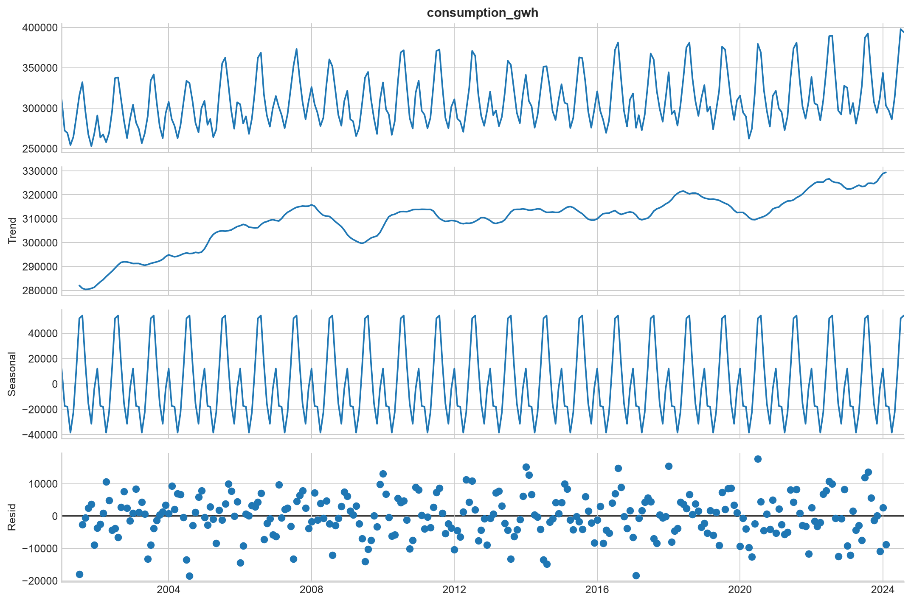
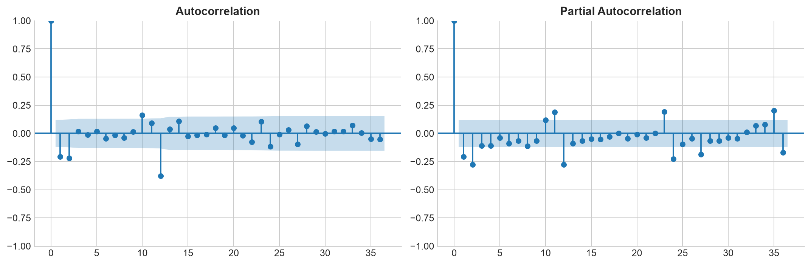
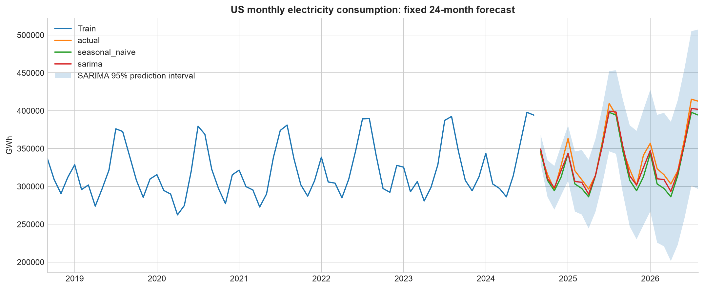

# Практическая работа №10 — вариант 1

Тема: интеллектуальный анализ и прогноз месячного электропотребления.
Задание: [методичка](../../Data_Mining_Practica_10.docx).

## Данные и подготовка

Реальный открытый ряд **EIA Electricity Retail Sales**, US, ALL: месячные продажи электроэнергии
конечным потребителям США (операционное измерение потребления),
2001-01–2026-08, 308 наблюдений, единица — GWh.
[JSON API](../../data/raw/electricity_monthly_eia.json), [источник EIA](https://www.eia.gov/electricity/data/browser/).
В кВт·ч значение переводится умножением на 1 000 000. Пропусков, повторных и отсутствующих месяцев нет;
интерполяция не применялась. Train: 2001-01–2024-08 (284 месяцев),
test: 2024-09–2026-08 (24 месяца). Перемешивания нет.

## Тренд, сезонность, стационарность

Среднее первых 12 train-месяцев — 282871.5 GWh,
последних 12 — 329488.1 GWh: долгосрочный уровень вырос.
Аддитивная декомпозиция только train показывает 12-месячный цикл;
**сезонный максимум приходится на месяц 8** (1 — январь, 12 — декабрь).
Сравнивается сезонная компонента, чтобы тренд не смещал средние по месяцам.

| series | statistic | p_value | lags | nobs |
| --- | --- | --- | --- | --- |
| train | -2.3815 | 0.1470 | 14 | 269 |
| first_difference | -5.8930 | 0.0000 | 13 | 269 |
| seasonal_and_first_difference | -6.4426 | 0.0000 | 11 | 259 |

ADF проверяет нулевую гипотезу единичного корня; p < 0.05 позволяет её отвергнуть,
но не доказывает все свойства стационарности. ACF/PACF построены после сезонной и первой разности.

## Модели и честная оценка

Последние 24 месяца **внутри train** использованы для выбора параметров по RMSE.
Проверены три SARIMA с сезонным порядком (0,1,1,12); выбран порядок (1, 1, 0).
Финальная модель обучена на полном train. Test не участвует в выборе параметров.
Baseline циклически повторяет последние 12 значений train; обе модели одновременно
прогнозируют 24 месяца от одной даты и не получают истинных значений test.

| order | seasonal_order | validation_rmse | converged |
| --- | --- | --- | --- |
| (0, 1, 1) | (0,1,1,12) | 15029.8035 | True |
| (1, 1, 0) | (0,1,1,12) | 14347.2218 | True |
| (1, 1, 1) | (0,1,1,12) | 15211.1528 | True |

| model | mae | rmse | r2 | mape_percent |
| --- | --- | --- | --- | --- |
| Seasonal naive | 11327.0135 | 13533.5729 | 0.8604 | 3.3398 |
| SARIMA | 7711.8144 | 9114.6634 | 0.9367 | 2.2346 |

MAE и RMSE измеряются в GWh, MAPE — в процентах; все фактические значения положительны.
Наименьший RMSE здесь у **SARIMA**: 9114.66 GWh.
95% интервал SARIMA относится к новым наблюдениям при предположениях модели;
это не гарантия и не интервал среднего потребления.

## Вывод

В месячном потреблении обнаружены рост уровня и повторение сезонного цикла.
Сезонный пик определён на обучающем периоде: месяц 8.
Сравнение на одном фиксированном горизонте показало меньший RMSE у SARIMA.
Результат относится к одному историческому test-периоду и не гарантирует такую же точность в будущем.

Запуск: `PYTHONPATH=src .venv/bin/python -m breast_cancer_labs.labs.lab10_time_series`.
Таблицы проверки, прогнозы, параметры, сводка SARIMA и версии среды сохранены рядом с отчётом.
