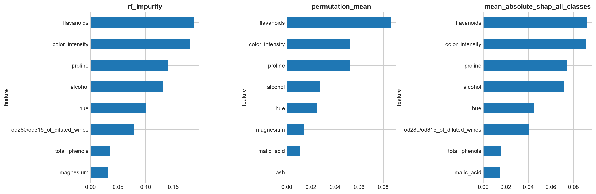
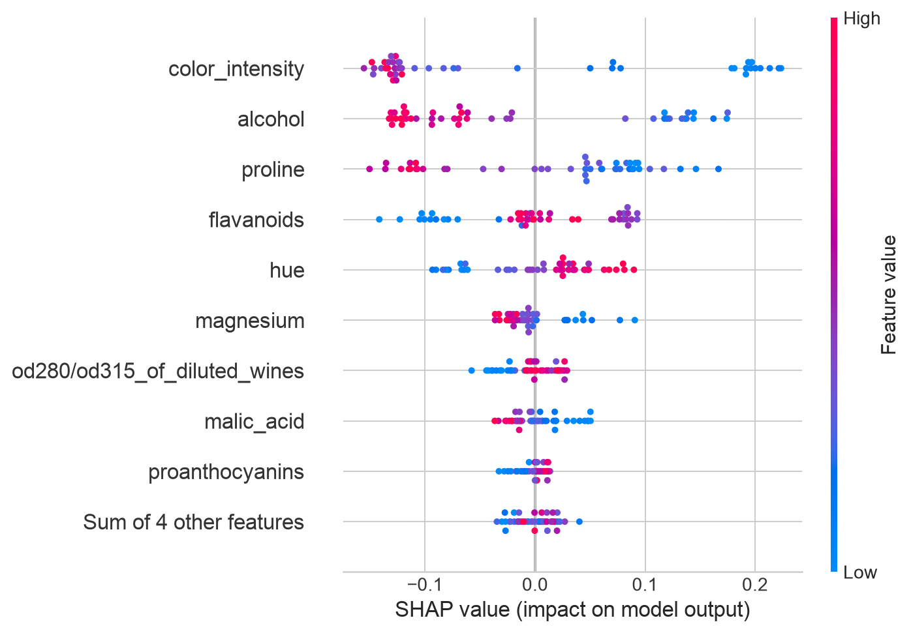
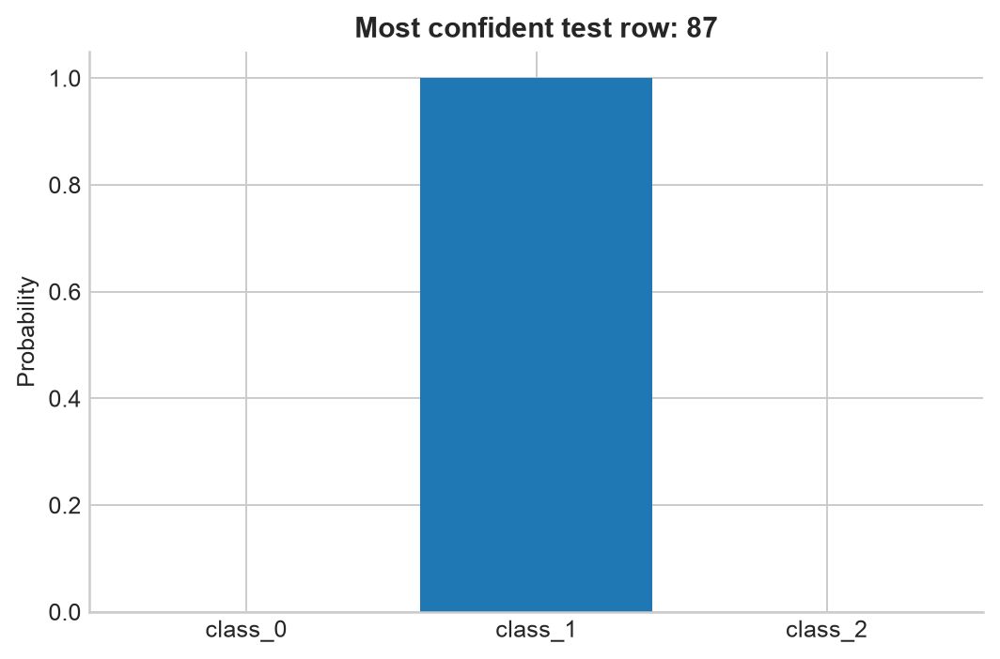
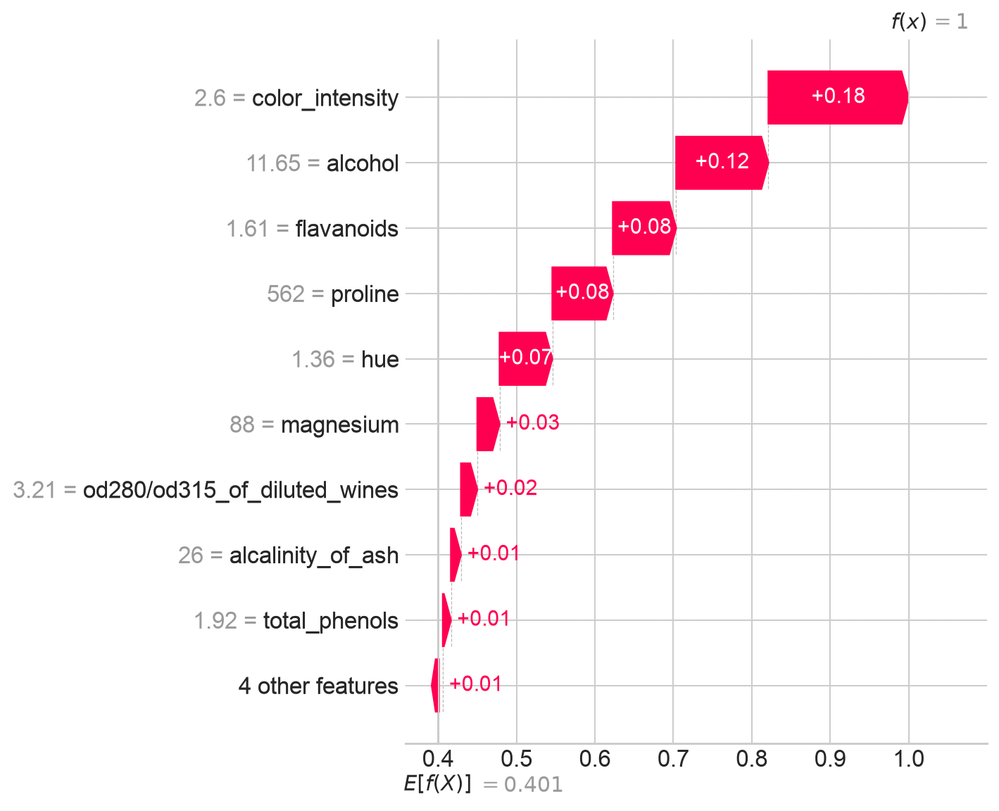
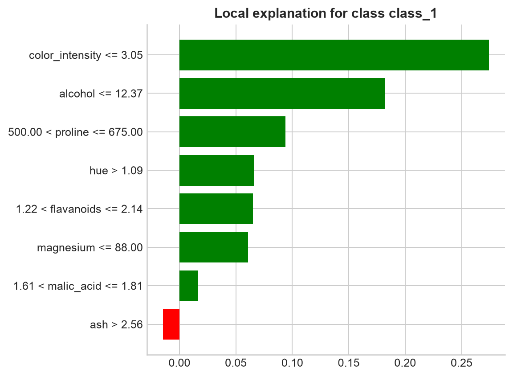

# Практическая работа №11 — вариант 1

Тема: объяснение химических признаков классов Wine через SHAP и LIME.
[Задание](../../Data_Mining_Practica_11.docx), [источник Wine](https://scikit-learn.org/stable/datasets/toy_dataset.html#wine-recognition-dataset).

## Данные и качество модели

Использован встроенный sklearn Wine: 178 образцов, 13 химических признаков,
три класса с численностями {0: 59, 1: 71, 2: 48}.
Пропуски: 0; точные повторы признаков: 0.
Стратифицированное разбиение 75/25: train=133, test=45.
Random Forest: 120 деревьев, random_state=42. Обучение использует только train.

| accuracy | macro_f1 |
| --- | --- |
| 1.0000 | 1.0000 |

## Общая важность

| feature | rf_impurity | permutation_mean | permutation_std | mean_absolute_shap_all_classes | mean_absolute_shap_selected_class |
| --- | --- | --- | --- | --- | --- |
| flavanoids | 0.1880 | 0.0861 | 0.0259 | 0.0920 | 0.0538 |
| color_intensity | 0.1807 | 0.0528 | 0.0313 | 0.0913 | 0.1369 |
| proline | 0.1398 | 0.0528 | 0.0190 | 0.0744 | 0.0831 |
| alcohol | 0.1321 | 0.0278 | 0.0096 | 0.0712 | 0.1065 |
| hue | 0.1013 | 0.0250 | 0.0133 | 0.0454 | 0.0434 |
| od280/od315_of_diluted_wines | 0.0784 | 0.0000 | 0.0000 | 0.0408 | 0.0186 |
| total_phenols | 0.0353 | 0.0000 | 0.0000 | 0.0158 | 0.0074 |
| malic_acid | 0.0287 | 0.0111 | 0.0111 | 0.0145 | 0.0184 |

Встроенная impurity-важность, падение test-Accuracy при перестановке (8 повторов)
и среднее |SHAP| по всем test-объектам и классам измеряют разные свойства.
Коррелирующие химические признаки могут делить важность; нулевое падение Accuracy
не означает, что признак никогда не используется деревьями.

## Специальное задание: самый уверенный прогноз

По максимуму вероятности **среди всех test-объектов** выбрана исходная строка
87. Максимум — 1.0000;
таких максимумов 3, при равенстве берётся первый в порядке test.
Истинный класс — 1, прогноз — 1 (class_1).
Вероятности классов 0/1/2: [0.0, 1.0, 0.0].
Выбор по уверенности не является отдельной оценкой качества модели и не гарантирует правильность.

SHAP объясняет **вероятность класса 1**, а не логит.
База 0.401065 + сумма вкладов 0.598935
= 1.000000; аддитивность проверена для всех test-объектов и классов с допуском 1e-6.
TreeExplainer использует распределение путей деревьев обученного леса.

| feature | value | shap_probability_contribution |
| --- | --- | --- |
| color_intensity | 2.6000 | 0.1787 |
| alcohol | 11.6500 | 0.1176 |
| flavanoids | 1.6100 | 0.0807 |
| proline | 562.0000 | 0.0772 |
| hue | 1.3600 | 0.0672 |
| magnesium | 88.0000 | 0.0284 |
| od280/od315_of_diluted_wines | 3.2100 | 0.0208 |
| alcalinity_of_ash | 26.0000 | 0.0128 |

LIME использует только train для построения окрестности и границ дискретизации,
2000 возмущённых объектов, 8 условий. Положительные веса поддерживают класс 1,
отрицательные уменьшают его локальный прогноз.
Взвешенный R² локального приближения — 0.5081, прогноз приближения — 1.0513.

| condition | weight |
| --- | --- |
| color_intensity <= 3.05 | 0.2741 |
| alcohol <= 12.37 | 0.1823 |
| 500.00 < proline <= 675.00 | 0.0941 |
| hue > 1.09 | 0.0664 |
| 1.22 < flavanoids <= 2.14 | 0.0652 |
| magnesium <= 88.00 | 0.0608 |
| 1.61 < malic_acid <= 1.81 | 0.0167 |
| ash > 2.56 | -0.0145 |

## Два сходства и два различия

1. Оба метода объясняют выход уже обученного Random Forest для одного и того же объекта и класса.
2. Оба показывают положительное и отрицательное влияние признаков относительно своего контекста объяснения.
3. TreeSHAP раскладывает вероятность относительно базового значения аддитивно;
   LIME обучает взвешенное локальное линейное приближение, которое может не воспроизвести вероятность точно.
4. SHAP в данном опыте использует структуру деревьев; LIME зависит от случайных возмущений,
   дискретизации и ширины окрестности. Поэтому порядок и знаки важностей могут различаться.

## Вывод

Качество Random Forest проверено на отложенной выборке, затем объяснён самый уверенный test-прогноз.
Общие ранги и локальные вклады помогают понять использование химических признаков моделью.
SHAP и LIME отвечают на близкие вопросы разными способами и не обязаны совпадать.
Эти объяснения описывают модельные зависимости, но не доказывают причинное влияние состава на класс вина.

Запуск: `PYTHONPATH=src .venv/bin/python -m breast_cancer_labs.labs.lab11_explainable_ai`.
