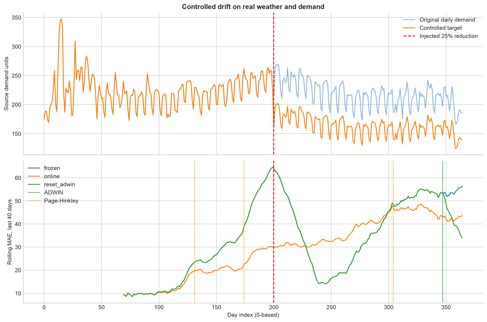
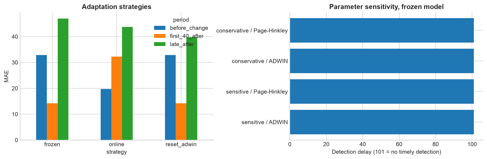

# Практическая работа №12 — вариант 1

Тема: изменение зависимости дневного электропотребления от погоды и адаптация модели.
[Задание](../../Data_Mining_Practica_12.docx).

## Данные и проверяемая гипотеза

Основа — реальные 365 дней Victoria, Australia, 2014: [elecdaily](../../data/raw/elecdaily.csv),
[источник fpp2/AEMO/BOM](https://vincentarelbundock.github.io/Rdatasets/doc/fpp2/elecdaily.html).
Temperature — °C, WorkDay — 0/1, Demand — исходный суточный агрегат
(документация обозначает GW; в кВт·ч здесь не переводится).
Временной порядок восстановлен по описанию: 2014-01-01–2014-12-31; пропусков нет.

**Контролируемый искусственный сценарий на реальных данных:** начиная с индекса
200 (2014-07-20) цель уменьшена на 25% при сохранении погоды и календаря.
Так моделируется гипотеза изменения поведения после тарифа; это **не установленное событие
в Австралии**. Исходный Demand сохранён отдельно. Известная граница позволяет оценить задержку.
Сигналы до неё называются ложными только относительно введённого изменения;
они также могут отражать естественную сезонность исходного ряда.

## Онлайн оценка и стратегии

Первоначальное обучение — 60 дней. StandardScaler признаков и нормировка цели
оцениваются только на этом начальном периоде и далее фиксируются.
Признаки: температура и её квадрат, рабочий день, недельные sin/cos.
Годовые sin/cos исключены: 60-дневный warmup не позволяет надёжно оценить годовую сезонность.
SGDRegressor: squared_error, eta0=.003, constant learning rate, alpha=.001,
shuffle=False, random_state=42. Каждый из последующих 305 дней:
сначала прогноз → ошибка → детекторы → обновление. Текущий ответ считается доступным после прогноза.

Сравнены frozen (без обновления), online (partial_fit ежедневно), reset_adwin
(фиксированная модель между сигналами и переобучение на последних 60 уже известных строках после чувствительного ADWIN).
Все стратегии стартуют одинаково; известный момент изменения не передаётся моделям и детекторам.
Детекторы получают ограниченный сигнал |ошибка|/(|ошибка|+σ_warmup), а график показывает MAE
в исходной шкале. Page–Hinkley настроен на рост средней ошибки, delta=.005, min_instances=30.

## Детекторы и параметры

| strategy | config | detector | adwin_delta | ph_threshold | alarms | false_before_change | first_timely_alarm | delay | late_alarms | timely_detected |
| --- | --- | --- | --- | --- | --- | --- | --- | --- | --- | --- |
| frozen | sensitive | ADWIN | 0.0100 | 5.0000 | 1 | 0 | nan | nan | 1 | False |
| frozen | sensitive | Page-Hinkley | 0.0100 | 5.0000 | 3 | 2 | nan | nan | 1 | False |
| frozen | conservative | ADWIN | 0.0020 | 10.0000 | 0 | 0 | nan | nan | 0 | False |
| frozen | conservative | Page-Hinkley | 0.0020 | 10.0000 | 2 | 1 | nan | nan | 1 | False |
| online | sensitive | ADWIN | 0.0100 | 5.0000 | 1 | 0 | 251.0000 | 51.0000 | 0 | True |
| online | sensitive | Page-Hinkley | 0.0100 | 5.0000 | 2 | 1 | nan | nan | 1 | False |
| online | conservative | ADWIN | 0.0020 | 10.0000 | 1 | 0 | 283.0000 | 83.0000 | 0 | True |
| online | conservative | Page-Hinkley | 0.0020 | 10.0000 | 1 | 0 | 200.0000 | 0.0000 | 0 | True |
| reset_adwin | sensitive | ADWIN | 0.0100 | 5.0000 | 1 | 0 | nan | nan | 1 | False |
| reset_adwin | sensitive | Page-Hinkley | 0.0100 | 5.0000 | 3 | 2 | nan | nan | 1 | False |
| reset_adwin | conservative | ADWIN | 0.0020 | 10.0000 | 0 | 0 | nan | nan | 0 | False |
| reset_adwin | conservative | Page-Hinkley | 0.0020 | 10.0000 | 1 | 1 | nan | nan | 0 | False |

Для каждой стратегии сравниваются ADWIN delta=.01/.002 и Page–Hinkley threshold=5/10.
Первый своевременный сигнал ищется в [200, 300], задержка — время минус 200.
Отсутствующее значение означает отсутствие своевременного сигнала; поздние сигналы считаются отдельно.
У чувствительных настроек порог доказательств ниже, но реальный результат и ложные сигналы
нужно оценивать по таблице, а не предполагать обязательное улучшение.

## Как ошибка меняется после сигнала

| strategy | period | n | mae | rmse |
| --- | --- | --- | --- | --- |
| frozen | before_change | 140 | 32.8326 | 41.2055 |
| frozen | first_40_after | 40 | 14.1927 | 17.0296 |
| frozen | late_after | 125 | 46.9635 | 51.7111 |
| online | before_change | 140 | 19.6768 | 23.2641 |
| online | first_40_after | 40 | 32.2207 | 33.8897 |
| online | late_after | 125 | 43.6667 | 47.3798 |
| reset_adwin | before_change | 140 | 32.8326 | 41.2055 |
| reset_adwin | first_40_after | 40 | 14.1927 | 17.0296 |
| reset_adwin | late_after | 125 | 39.7542 | 45.9588 |

Для каждого зарегистрированного сигнала ниже сравниваются до 20 предшествующих и
до 20 последующих прогнозов; день сигнала исключён. Размеры окон указаны отдельно.

| strategy | config | detector | alarm_time | before_n | after_n | mae_20_before | mae_20_after |
| --- | --- | --- | --- | --- | --- | --- | --- |
| frozen | sensitive | Page-Hinkley | 131 | 20 | 20 | 33.8810 | 20.6301 |
| frozen | conservative | Page-Hinkley | 169 | 20 | 20 | 46.3399 | 64.8252 |
| frozen | sensitive | Page-Hinkley | 174 | 20 | 20 | 50.7200 | 67.8437 |
| frozen | sensitive | Page-Hinkley | 304 | 20 | 20 | 50.2212 | 55.6637 |
| frozen | sensitive | ADWIN | 347 | 20 | 17 | 49.2727 | 64.3621 |
| frozen | conservative | Page-Hinkley | 355 | 20 | 9 | 53.0245 | 69.6110 |
| online | sensitive | Page-Hinkley | 161 | 20 | 20 | 20.6438 | 32.4482 |
| online | conservative | Page-Hinkley | 200 | 20 | 20 | 28.4022 | 33.8914 |
| online | sensitive | ADWIN | 251 | 20 | 20 | 37.7227 | 40.1896 |
| online | conservative | ADWIN | 283 | 20 | 20 | 48.6824 | 46.4155 |
| online | sensitive | Page-Hinkley | 358 | 20 | 6 | 40.8348 | 57.3614 |
| reset_adwin | sensitive | Page-Hinkley | 131 | 20 | 20 | 33.8810 | 20.6301 |
| reset_adwin | conservative | Page-Hinkley | 169 | 20 | 20 | 46.3399 | 64.8252 |
| reset_adwin | sensitive | Page-Hinkley | 174 | 20 | 20 | 50.7200 | 67.8437 |
| reset_adwin | sensitive | Page-Hinkley | 304 | 20 | 20 | 50.2212 | 55.6637 |
| reset_adwin | sensitive | ADWIN | 347 | 20 | 17 | 49.2727 | 11.3529 |

Снижение ошибки после сигнала не доказывает эффект самого детектора:
online обновляется и без сигнала; только reset_adwin применяет явный сброс.
Изменение сезонности или дисперсии тоже способно вызвать сигнал.
После сброса в день 347 MAE изменился с 49.27 на 11.35 (окна 20 и 17 дней); задержка относительно введённого изменения — 147 дней.
У online MAE до изменения — 19.68,
в первые 40 дней после — 32.22,
в поздний период — 43.67:
ежедневное обновление само по себе не обеспечило снижение ошибки в этом сезонном потоке.
У frozen ошибка сразу после вмешательства уменьшилась: снижение цели частично
компенсировало прежнее смещение модели. Поэтому рост ошибки не является необходимым
следствием каждого изменения зависимости.

## Вывод

Построен хронологический регрессионный поток дневного потребления с известным искусственным изменением.
ADWIN и Page–Hinkley проверены с двумя комбинациями параметров на ошибках до обновления модели.
Таблицы показывают задержки, ранние сигналы и изменение MAE у трёх стратегий на одном потоке.
Результат зависит от заданной силы изменения и одного года наблюдений; реальную причину тарифного сдвига детекторы не устанавливают.

Запуск: `PYTHONPATH=src .venv/bin/python -m breast_cancer_labs.labs.lab12_concept_drift`.
