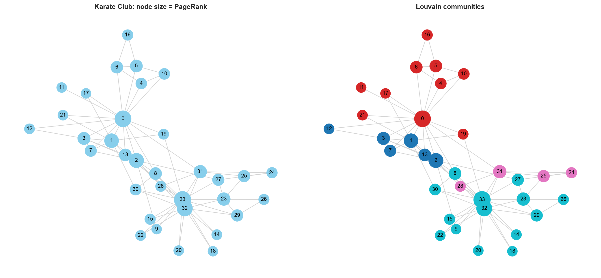
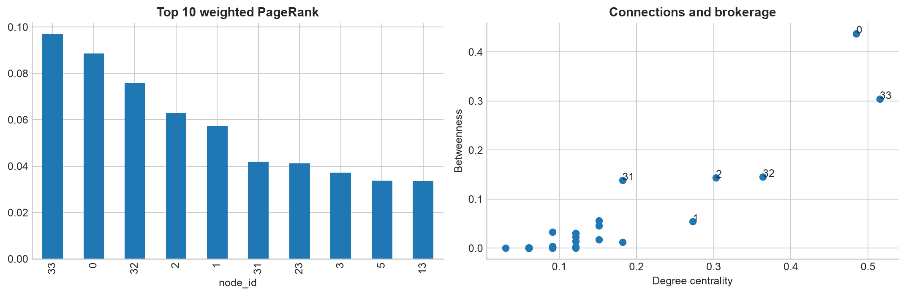

# Практическая работа №13 — вариант 1

Тема: влиятельные участники социальной сети.
[Задание](../../Data_Mining_Practica_13.docx).
Источник: встроенный [NetworkX Karate Club](https://networkx.org/documentation/stable/reference/generated/networkx.generators.social.karate_club_graph.html),
социальные связи 34 участников клуба Захари. Номера узлов — идентификаторы, не имена людей.

## Построение и структура графа

Использован `nx.karate_club_graph()`: 34 узла, 78 рёбер,
граф неориентированный, компонент связности 1, петель 0.
Средняя степень — 4.5882, плотность — 0.1390.
Список рёбер сохранён в [edges.csv](edges.csv), поэтому структуру можно проверить.
Вес ребра означает силу взаимодействия: PageRank и Louvain учитывают его как силу;
closeness и betweenness считают кратчайшие пути по числу рёбер, без весов.
Визуальное расстояние spring-layout не является географическим или социальным измерением.

## Сравнение первых пяти узлов по центральности

| rank | degree_centrality | closeness | betweenness | pagerank |
| --- | --- | --- | --- | --- |
| 1 | 33 | 0 | 0 | 33 |
| 2 | 0 | 2 | 33 | 0 |
| 3 | 32 | 33 | 32 | 32 |
| 4 | 2 | 31 | 2 | 2 |
| 5 | 1 | 8 | 31 | 1 |

| node_id | degree | degree_centrality | closeness | betweenness | pagerank | community |
| --- | --- | --- | --- | --- | --- | --- |
| 0 | 16 | 0.4848 | 0.5690 | 0.4376 | 0.0885 | 2 |
| 1 | 9 | 0.2727 | 0.4853 | 0.0539 | 0.0574 | 1 |
| 2 | 10 | 0.3030 | 0.5593 | 0.1437 | 0.0628 | 1 |
| 8 | 5 | 0.1515 | 0.5156 | 0.0559 | 0.0334 | 4 |
| 31 | 6 | 0.1818 | 0.5410 | 0.1383 | 0.0420 | 3 |
| 32 | 12 | 0.3636 | 0.5156 | 0.1452 | 0.0759 | 4 |
| 33 | 17 | 0.5152 | 0.5500 | 0.3041 | 0.0970 | 4 |

Лидер PageRank — узел **33** (0.0970),
лидер betweenness — **0** (0.4376).
PageRank оценивает вес связей с другими важными узлами, betweenness — долю кратчайших путей,
проходящих через посредника. Поэтому участник плотной группы может иметь высокий PageRank,
а узел, связывающий группы, — высокую betweenness при другом числе связей.
Degree измеряет число соседей, closeness — доступность остальных узлов по коротким путям.

## Louvain

При seed=42 и стандартном resolution=1 найдено 4 сообществ
размеров [6, 10, 4, 14], взвешенная модульность — 0.4266.
Модульность оценивает относительную концентрацию связей внутри найденных групп;
это не точность классификации и не доказательство социальной причины разделения клуба.
Номера сообществ произвольны; настройки и веса влияют на разбиение.

## Вывод

Все узлы связаны в одну компоненту, но роли участников различаются по выбранной метрике.
PageRank выделил узел 33, а betweenness — узел 0.
Louvain выявил 4 сообществ с модульностью 0.4266.
Выводы относятся к этой небольшой исторической сети и используемой интерпретации весов.

Запуск: `PYTHONPATH=src .venv/bin/python -m breast_cancer_labs.labs.lab13_graph_analysis`.
