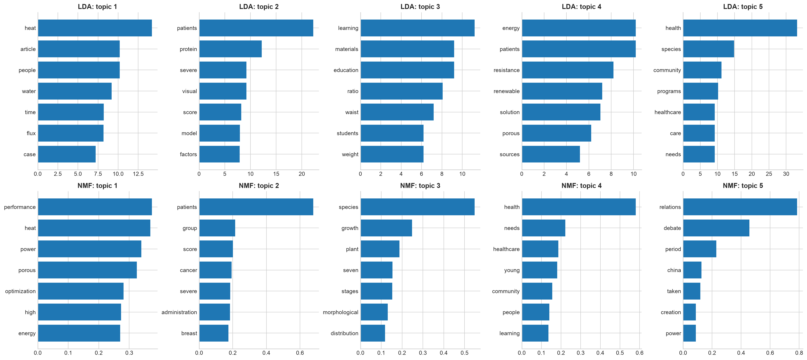
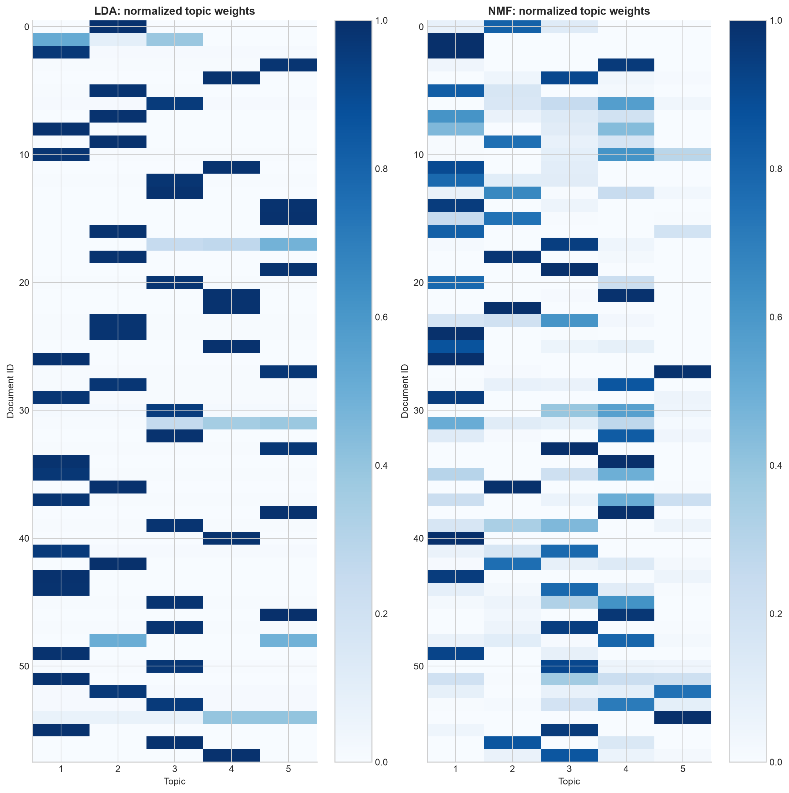

# Практическая работа №14 — вариант 1

Тема: скрытые темы научных статей по аннотациям.
[Задание](../../Data_Mining_Practica_14.docx).

## Корпус и обработка

Использованы **58 реальных англоязычных аннотаций научных статей 2024 года** из
[OpenAlex](https://docs.openalex.org/api-entities/works/work-object#abstract_inverted_index).
Запрос: type=article, language=en, has_abstract=true, publication_year=2024,
sample=60, seed=42, per-page=60. Ответ сохранён в [исходный JSON](../../data/raw/scientific_abstracts_openalex.json);
идентификаторы, DOI, названия и восстановленные аннотации — в [corpus.csv](corpus.csv).
Темы первичного каталога сохранены только как справка и не передаются в модель.

| received | with_abstract | empty_after_cleaning | duplicates | non_english_excluded |
| --- | --- | --- | --- | --- |
| 60 | 60 | 0 | 0 | 2 |

Текст приведён к нижнему регистру, оставлены английские буквенные токены длиной от 3,
Метаданные языка OpenAlex дополнительно проверены по английским служебным словам
и просмотром исключённых записей: две неанглийские аннотации исключены и сохранены отдельно.
Текст нормализован, удалены английские и общенаучные стоп-слова; min_df=2, max_df=.9.
Флексии не лемматизированы: формы слов могут остаться разными признаками — это ограничение.
Словарь общий: Bag-of-Words и TF-IDF имеют размер **(58, 772)**.
Матрицы сохранены отдельно. Искусственные тексты и размножение документов не использовались.

## LDA и NMF: три и пять тем

LDA обучается на счётчиках слов (batch, 60 итераций), NMF — на TF-IDF
(nndsvda, до 1000 итераций); random_state=42.
Корпус описывается целиком, показатели ниже рассчитаны **на обучающем корпусе**
и не являются оценкой обобщения на новые статьи.

| method | topics | documents | terms | train_perplexity | tfidf_reconstruction_error | iterations | zero_topic_rows |
| --- | --- | --- | --- | --- | --- | --- | --- |
| LDA | 3 | 58 | 772 | 779.2991 | nan | 60 | 0 |
| NMF | 3 | 58 | 772 | nan | 7.1863 | 219 | 0 |
| LDA | 5 | 58 | 772 | 818.3893 | nan | 60 | 0 |
| NMF | 5 | 58 | 772 | nan | 6.9640 | 71 | 0 |

Perplexity LDA и ошибка реконструкции NMF измеряют разные задачи и не сравниваются между собой.
При большем числе компонент ошибка реконструкции обычно падает; это само по себе
не доказывает лучшую интерпретируемость. Для одинакового подробного сравнения показаны пять тем,
но это не утверждение оптимальности k=5. У LDA perplexity для k=3 ниже, чем для k=5,
а пятикомпонентные темы сильнее смешивают направления: heat/water и energy/resistance.
NMF при k=5 дополнительно отделяет международные отношения от медицины и биологии;
поэтому для обзорной навигации здесь предпочтительнее NMF, с обязательным чтением примеров.
Человеческие названия ниже — интерпретации слов и документов, а не известные классы.

| method | topics | topic | kazakh_name | top_words |
| --- | --- | --- | --- | --- |
| LDA | 3 | 1 | Табиғи орта және инженерлік үдерістер | species, water, heat, resistance, article, high, time |
| LDA | 3 | 2 | Медицина және молекулалық биология | patients, cancer, protein, breast, health, significant, severe |
| LDA | 3 | 3 | Қоғамдық денсаулық пен білім | health, education, community, care, learning, energy, impact |
| NMF | 3 | 1 | Биологиялық түрлер және өсім | species, growth, plant, stages, seven, morphological, resistance |
| NMF | 3 | 2 | Клиникалық медицина және денсаулық | patients, health, group, education, score, cancer, severe |
| NMF | 3 | 3 | Энергетика және жылу техникасы | power, performance, heat, porous, energy, high, optimization |
| LDA | 5 | 1 | Жылу, су және қоршаған орта (аралас) | heat, article, people, water, time, flux, case |
| LDA | 5 | 2 | Пациенттер және клиникалық қауіп факторлары | patients, protein, severe, visual, score, model, factors |
| LDA | 5 | 3 | Білім, дене салмағы және материалдар (аралас) | learning, materials, education, ratio, waist, students, weight |
| LDA | 5 | 4 | Энергия және төзімділік (аралас) | energy, patients, resistance, renewable, solution, porous, sources |
| LDA | 5 | 5 | Қоғамдық денсаулық және биологиялық түрлер (аралас) | health, species, community, programs, healthcare, care, needs |
| NMF | 5 | 1 | Жылу техникасы және кеуекті материалдар | performance, heat, power, porous, optimization, high, energy |
| NMF | 5 | 2 | Клиникалық болжам және емдеу | patients, group, score, cancer, severe, administration, breast |
| NMF | 5 | 3 | Биологиялық түрлер және таралу | species, growth, plant, seven, stages, morphological, distribution |
| NMF | 5 | 4 | Денсаулық сақтау және қоғамдық қажеттіліктер | health, needs, healthcare, young, community, people, learning |
| NMF | 5 | 5 | Халықаралық және тарихи қатынастар | relations, debate, period, china, taken, creation, power |

LDA даёт вероятностные доли тем. NMF даёт неотрицательные веса; их нормировка до суммы 1
используется только для изображения и не превращает их в вероятности.
Номера тем между методами не совпадают; сопоставление по косинусному сходству
словарных весов с оптимальным взаимно однозначным соответствием:

| lda_topic | nmf_topic | term_cosine_similarity |
| --- | --- | --- |
| 1 | 1 | 0.6347 |
| 2 | 2 | 0.7381 |
| 3 | 5 | 0.0632 |
| 4 | 3 | 0.3757 |
| 5 | 4 | 0.7635 |

## Примеры двух тем каждого метода

### LDA, тақырып 1: Жылу, су және қоршаған орта (аралас)

Ключевые слова: heat, article, people, water, time, flux, case.

Документ 55, вес 0.9905: [Impact of red mud on soil properties and revegetation species growth in bauxite mining land reclamation](https://openalex.org/W4403046882). Фрагмент аннотации: «Bauxite mining, a key aluminum production process, can cause environmental degradation, soil erosion, and biodiversity loss. Reclamation measures like reforestation and water management can restore balance. Red mud, a by-product of alumina production, can enhance soil fertility and plant growth in post-bauxite mining reclamation areas. Its alkalinity and mineral composition reduce reliance on synthetic fertilizers, promoting sustainable soil management and addressing environmental challenges. This study aimed to examine the impact of red mud on soil characteristics and the growth of plants in …».

Документ 26, вес 0.9889: [Conjugate gradient method with regularization in estimating mold surface heat flux during continuous casting](https://openalex.org/W4392563749). Фрагмент аннотации: «The reconstruction of the boundary heat flux between solidifying steel and water-cooled mold wall using measured temperature data is recognized as an inverse heat conduction problem (IHCP). A Tikhonov spatial regularization approach to enhance the smoothness of the Conjugate Gradient Method (CGMr) was proposed which incorporates three different orders of spatial regularization: zeroth, first, and second order. The optimal regularization parameter was selected using a modified L-curve method. The accuracy of the CGMr is investigated with Case 1: a triangular time-spatial variation heat flux, an…».

### LDA, тақырып 2: Пациенттер және клиникалық қауіп факторлары

Ключевые слова: patients, protein, severe, visual, score, model, factors.

Документ 42, вес 0.9930: [Acceptance and the influencing factors towards intermittent self-catheterisation among patients with neurogenic lower urinary tract dysfunction in China: a multicentre cross-sectional study](https://openalex.org/W4405175465). Фрагмент аннотации: «Objectives The psychological acceptance of intermittent self-catheterisation (ISC) significantly impacts its initial adoption and long-term compliance among patients. However, our understanding of this acceptance remains limited. This study aims to investigate ISC’s psychological acceptance and identify influencing factors among neurogenic lower urinary tract dysfunction (NLUTD) patients in China. Design A cross-sectional study design. Participants A total of 394 patients with NLUTD were recruited from 15 tertiary general hospitals in China. Outcome measure The patients completed a comprehensi…».

Документ 9, вес 0.9920: [Factors beyond Body Mass Index Associated with Cardiometabolic Risk among Children with Severe Obesity](https://openalex.org/W4402841936). Фрагмент аннотации: «Background: The increasing prevalence of severe obesity among children and adolescents poses a significant challenge for pediatricians and general practitioners. This study aimed to investigate the relationships between biochemical results, anthropometry, blood pressure measurements, and bioimpedance analysis (BIA)-derived parameters to identify potential cardiometabolic complications associated with severe obesity. Methods: This study included 347 children (162 boys, 185 girls) aged 0–19 years, meeting the criteria for severe obesity based on BMI thresholds for different age groups. The patie…».

### NMF, тақырып 1: Жылу техникасы және кеуекті материалдар

Ключевые слова: performance, heat, power, porous, optimization, high, energy.

Документ 40, вес 1.0000: [Kaolin-Derived Porous Silico-Aluminate Nanoparticles as Absorbents for Emergency Disposal of Toluene Leakage](https://openalex.org/W4399292863). Фрагмент аннотации: «To rapidly eliminate toluene from aqueous environments during leakage accidents, this paper synthesized porous silico-aluminate nanoparticles (SANs) via a hydrothermal method, using cost-effective and non-toxic natural kaolin as the basic raw material. The morphology and structure of the porous SANs were characterized using scanning electron microscopy (SEM), X-ray photoelectron spectroscopy (XPS), X-ray diffraction (XRD), and BET-specific surface area tests. The effects of different conditions, such as the dosage of porous SANs, initial concentration of toluene, temperature, capture time, and…».

Документ 26, вес 1.0000: [Conjugate gradient method with regularization in estimating mold surface heat flux during continuous casting](https://openalex.org/W4392563749). Фрагмент аннотации: «The reconstruction of the boundary heat flux between solidifying steel and water-cooled mold wall using measured temperature data is recognized as an inverse heat conduction problem (IHCP). A Tikhonov spatial regularization approach to enhance the smoothness of the Conjugate Gradient Method (CGMr) was proposed which incorporates three different orders of spatial regularization: zeroth, first, and second order. The optimal regularization parameter was selected using a modified L-curve method. The accuracy of the CGMr is investigated with Case 1: a triangular time-spatial variation heat flux, an…».

### NMF, тақырып 2: Клиникалық болжам және емдеу

Ключевые слова: patients, group, score, cancer, severe, administration, breast.

Документ 22, вес 1.0000: [Incidence of Fatigue Following Dexamethasone Administration for Supportive Therapy and Efficacy of Tapering in Perioperative Chemotherapy for Breast Cancer: A Retrospective Observational Study](https://openalex.org/W4400873087). Фрагмент аннотации: «In perioperative chemotherapy for breast cancer, dexamethasone (DEX) is administered at high dose to prevent adverse effects. Abrupt cessation of high-dose DEX treatment induces fatigue, but the incidence of the fatigue is uncertain. In this study, we retrospectively evaluated the incidence of fatigue following DEX administration for supportive therapy and the improvement of fatigue with DEX tapering, a gradual reduction of the daily dose, in breast cancer patients. The subjects were 124 patients with breast cancer receiving epirubicin- or docetaxel-based regimens as perioperative chemotherapy…».

Документ 36, вес 0.9950: [Comparison of Prognostic Value of Predictors of Mortality in Patients with Cirrhosis and Refractory Ascites](https://openalex.org/W4402624501). Фрагмент аннотации: «The Model for End-Stage Liver Disease-Sodium score (MELDNa) has been developed that has a better prognostic value to predict early mortality but has not been frequently used in cirrhotic and refractory ascites patients with recurrent incidences of severe hyponatremia. Objective: To compare the prognostic value of severe hyponatremia, Child-Pugh score, and the model for end-stage liver disease-sodium score in cirrhotic and refractory ascitic patients. Methods: A prospective, observational study was conducted at the Hepatology Department, Bakhtawar Amin Trust Hospital, Multan from March 2023 to …».

В LDA тема 1 смешивает рекультивацию почв и теплоперенос, то есть её научное содержание
неоднородно; тема 2 объединяет клинические факторы принятия катетеризации и риска ожирения.
В NMF тема 1 связывает пористые сорбенты и моделирование теплового потока,
а тема 2 — исходы химиотерапии и прогноз смертности при циррозе.
Эти пары подтверждают, что «тема» может объединять разные прикладные задачи по общей терминологии.
Высокий вес означает близость к найденной теме, а не истинный класс статьи.
Сопоставлять следует слова и содержание аннотаций: один номер темы у разных методов
не означает одинаковое научное направление.

## Вывод

Из реальных аннотаций построены частотная и TF-IDF матрицы, проверены LDA/NMF с 3 и 5 темами.
LDA даёт вероятностные смеси, но k=5 увеличил обучающую perplexity и дал смешанные темы.
NMF с пятью компонентами полезнее для обзорной навигации по характерным терминам,
хотя широкие и смешанные темы требуют чтения статей и не заменяют экспертную классификацию.
Ограничения — малая выборка, один год публикаций, отсутствие лемматизации и проверка одного seed.

Запуск: `PYTHONPATH=src .venv/bin/python -m breast_cancer_labs.labs.lab14_topic_modeling`.
