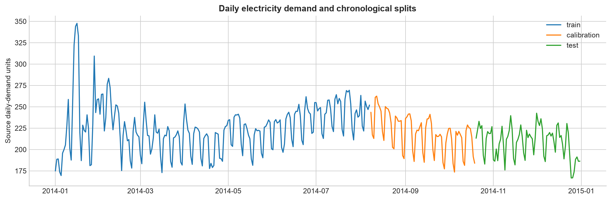
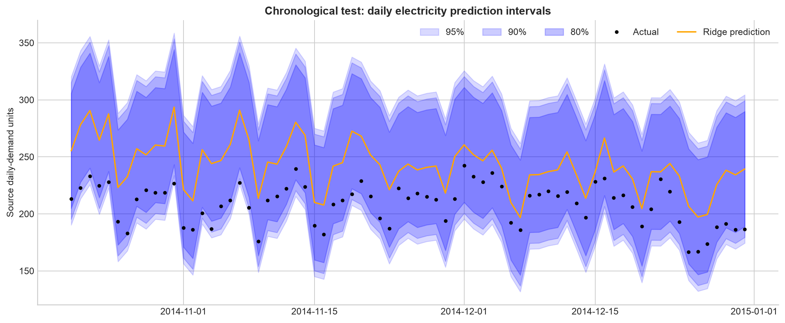
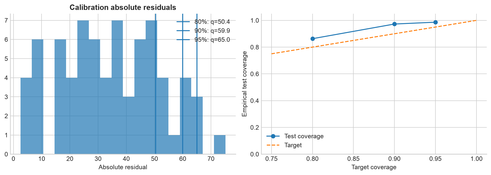

# Практическая работа №15 — вариант 1

Тема: неопределённость прогнозов суточного электропотребления.
[Задание](../../Data_Mining_Practica_15.docx).

## Источник и признаки

Реальные 365 дневных наблюдений Victoria, Australia, за 2014 год: fpp2 **elecdaily**,
[CSV](../../data/raw/elecdaily.csv), [документация](https://vincentarelbundock.github.io/Rdatasets/doc/fpp2/elecdaily.html).
Первичные источники — AEMO и Australian Bureau of Meteorology.
Цель — исходный агрегированный показатель Demand. Документация fpp2 обозначает его GW даже
для дневной агрегации; поэтому здесь сохранены исходные единицы и **не заявлен пересчёт в кВт·ч**.
Temperature — дневной максимум температуры в °C, WorkDay — рабочий день (0/1).
Даты восстановлены как последовательные дни 2014 года согласно описанию источника;
пропусков нет, исходные значения не изменены.

Признаки: температура, её квадрат, WorkDay, sin/cos годового и недельного календарного цикла.
Наблюдаемая температура служит известной ковариатой: для реального прогноза заранее
понадобится её прогноз, а его дополнительная неопределённость здесь не учтена.

## Хронологическое разбиение и модель

Train — 219 дней (2014-01-01–2014-08-07),
calibration — 73 (2014-08-08–2014-10-19),
test — 73 (2014-10-20–2014-12-31).
Перемешивания нет. StandardScaler + Ridge(alpha=10) обучены только на train;
calibration задаёт квантили, test используется только для итоговой оценки.
Модель не переобучается на calibration после выбора квантилей.

## Наблюдаемые результаты

| mae | rmse | r2 |
| --- | --- | --- |
| 33.6990 | 36.5201 | -3.1797 |

Для каждого α использован **k = ceil((n_cal+1)(1−α))** и k-й абсолютный
калибровочный остаток q. Если k > n_cal, конечной границы нет: q=∞.
Индивидуальный прогнозный интервал равен [ŷ−q, ŷ+q].

| target_coverage | calibration_n | order_statistic_k | q | test_n | covered | empirical_coverage | mean_width |
| --- | --- | --- | --- | --- | --- | --- | --- |
| 0.8000 | 73 | 60 | 50.4332 | 73 | 63 | 0.8630 | 100.8663 |
| 0.9000 | 73 | 67 | 59.9421 | 73 | 71 | 0.9726 | 119.8842 |
| 0.9500 | 73 | 71 | 64.9959 | 73 | 72 | 0.9863 | 129.9918 |

Чем выше целевой уровень покрытия, тем больше или равно q и ширина вложенных интервалов.
MAE/RMSE и ширина имеют единицы Demand, R² и покрытие безразмерны.
Это интервалы **для новых индивидуальных наблюдений**, а доверительный интервал среднего
описывал бы неопределённость среднего уровня и решал другую задачу.

## Сезонность и ограничения

В южном полушарии декабрь–февраль — лето, сентябрь–ноябрь — весна.
Годовой график позволяет видеть недельные колебания и сезонные изменения;
одного года недостаточно для проверки повторяемости годового цикла.
Test охватывает лишь часть весны и начало лета, поэтому сравнение всех четырёх сезонов невозможно.

| season | target_coverage | n | coverage | mean_width | mae |
| --- | --- | --- | --- | --- | --- |
| spring | 0.8000 | 42 | 0.7857 | 100.8663 | 39.7657 |
| summer | 0.8000 | 31 | 0.9677 | 100.8663 | 25.4796 |
| spring | 0.9000 | 42 | 0.9524 | 119.8842 | 39.7657 |
| summer | 0.9000 | 31 | 1.0000 | 119.8842 | 25.4796 |
| spring | 0.9500 | 42 | 0.9762 | 129.9918 | 39.7657 |
| summer | 0.9500 | 31 | 1.0000 | 129.9918 | 25.4796 |

Для обменных наблюдений split conformal даёт конечновыборочное **маргинальное** покрытие,
но не точное покрытие каждой точки или группы. Последовательные дневные данные зависимы,
а train/calibration/test относятся к разным сезонам: обменность здесь не подтверждена.
Поэтому 80/90/95% — номинальные уровни, формальную гарантию для этого ряда утверждать нельзя.
Покрытие и ширина выше — фактически измеренные значения на одном test-периоде;
простая постоянная ширина не адаптируется к изменению дисперсии ошибки.

## Вывод

Обучена базовая регрессия суточного потребления с погодными и календарными признаками.
Три интервала рассчитаны по отдельным калибровочным остаткам и проверены на будущих днях.
Увеличение номинального покрытия расширяет интервалы, а фактическое покрытие зависит от сезона.
Для применения к временному ряду нужна дополнительная проверка зависимости и устойчивости к сдвигу распределения.

Запуск: `PYTHONPATH=src .venv/bin/python -m breast_cancer_labs.labs.lab15_prediction_intervals`.
